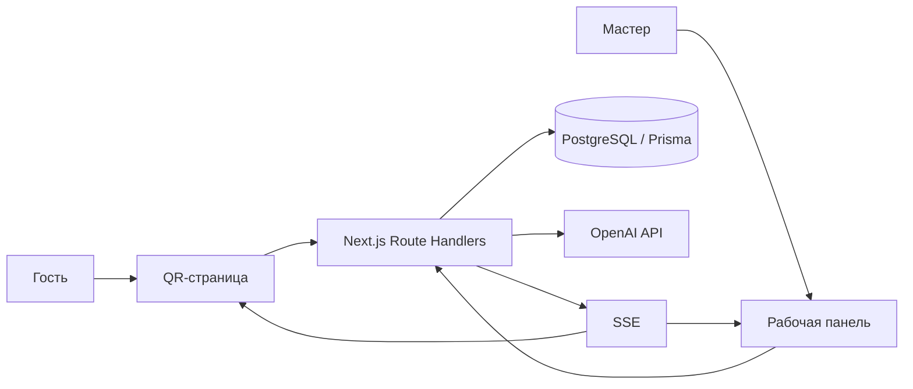

# HoReCa QR — автоматизация обслуживания гостей

**Роман Бочаров | Business & System Analysis · Product Development**

QR-сервис для кальянной: многоразовая метка связывает физическое устройство с текущей сессией обслуживания. Гость видит состав и крепость, может позвать мастера или запросить рецепт. Мастер работает с панелью активных сессий и уведомлениями.

## Задача бизнеса

Гипотеза проблемы: информация о заказе остаётся у сотрудника, а дополнительные запросы гостя требуют ручной коммуникации. Решение — единое цифровое пространство для контекста заказа и запросов к мастеру.

Моя роль в проекте: разработка цифрового сервиса и проработка пользовательских сценариев. Документы ниже реконструированы по исходникам; это не исторически утверждённое ТЗ. AS-IS означает обнаруженное в коде поведение, TO-BE — предлагаемое развитие. Работоспособность развёрнутого сервиса, эффект на бизнес и масштабы внедрения не проверялись.

| Масштаб исходников | Значение |
|---|---:|
| Группы API-маршрутов | 17 |
| HTTP-операции | 23 |
| Модели Prisma | 6 |
| Типы бизнес-событий SSE | 4 |
| Градации крепости в интерфейсе | 5 |

## Материалы кейса

| Артефакт | Что демонстрирует |
|---|---|
| [Продукт и CJM](product/vision-cjm.md) | Проблема, персоны, клиентский путь |
| [Метрики и roadmap](product/roadmap-metrics.md) | Гипотезы и измерение эффекта |
| [Требования](analysis/requirements.md) | Функциональность, правила, критерии |
| [Use cases](analysis/use-cases.md) | Сценарии и альтернативы |
| [Архитектура и данные](architecture/system-data.md) | Next.js, Prisma, ERD, SSE, AI |
| [Диаграммы](diagrams/README.md) | Sequence, состояния, процесс |
| [BPMN](diagrams/recipe-request.bpmn) | Запрос рецепта, открывается в BPMN-редакторе |
| [API](api/contract.md) | Выбранные контракты и событийная модель |
| [OpenAPI](api/openapi.yaml) | Обезличенный пример API |
| [Тестовые сценарии](testing/test-cases.md) | Приёмка и проверка исключений |

## Ключевые аналитические решения

- Отделить физическую QR-метку от временной сессии.
- Хранить снимок состава заказа отдельно от справочника.
- Разделить жизненный цикл сессии и флаги запросов гостя.
- Использовать SSE для доставки событий в интерфейсы.
- Превратить голосовую команду в черновик формы, оставляя подтверждение человеку.
- Измерять не только трафик, но и успешность обслуживания (предлагаемая инструментализация).

Публикуются только аналитические материалы. Исходники, дампы, адреса действующего сервиса, клиентские данные и приватный аудит исключены.

[Telegram](https://t.me/romashbo) · [GitHub](https://github.com/Romashbo)
