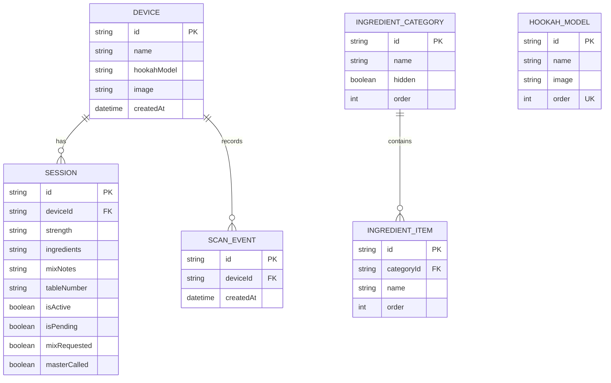

# Архитектура и модель данных

[К кейсу](../README.md)

## AS-IS

Next.js 16.2.4 / React 19.2.4 / TypeScript, Prisma 6.19.3, PostgreSQL. Route Handlers находятся в одном приложении с интерфейсами; это монолит, не микросервисная система. Prisma-схема задаёт PostgreSQL, несмотря на наличие файла dev.db в архиве. Его содержимое не анализировалось.

| Компонент | Ответственность |
|---|---|
| QR UI | Публичная карточка, гостевые запросы |
| Master UI | Рабочие сессии, справочники, рецепты, аналитика |
| Route Handlers | HTTP-контракты и правила |
| Prisma | ORM и модели данных |
| EventEmitter / SSE | Передача событий клиентам |
| OpenAI | whisper-1 для транскрибации, gpt-4o-mini для структурирования |

SSE — односторонний канал сервер→клиент; действия отправляются HTTP-запросами. Целевой вариант для масштабирования требует согласовать доставку между экземплярами и восстановление после reconnect.

## ERD

HookahModel — самостоятельный справочник; поле Device.hookahModel строковое, не внешний ключ. ingredients и mixNotes сериализованы строками, не нормализованные связи. При удалении Device схема предусматривает каскад для Session и ScanEvent; при удалении категории — для её элементов.

### Модель доступа

Гость и мастер — два типа взаимодействия, не полноценная многопользовательская RBAC. Вход мастера основан на пароле и cookie. Для публичного кейса описана целевая граница: гость видит только данные своей активной сессии и отправляет разрешённые запросы; мастер управляет сессиями и справочниками. Соответствие этой границе следует проверять отдельно.
