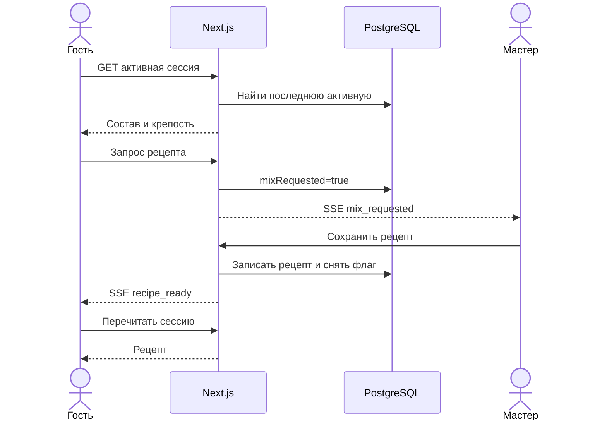
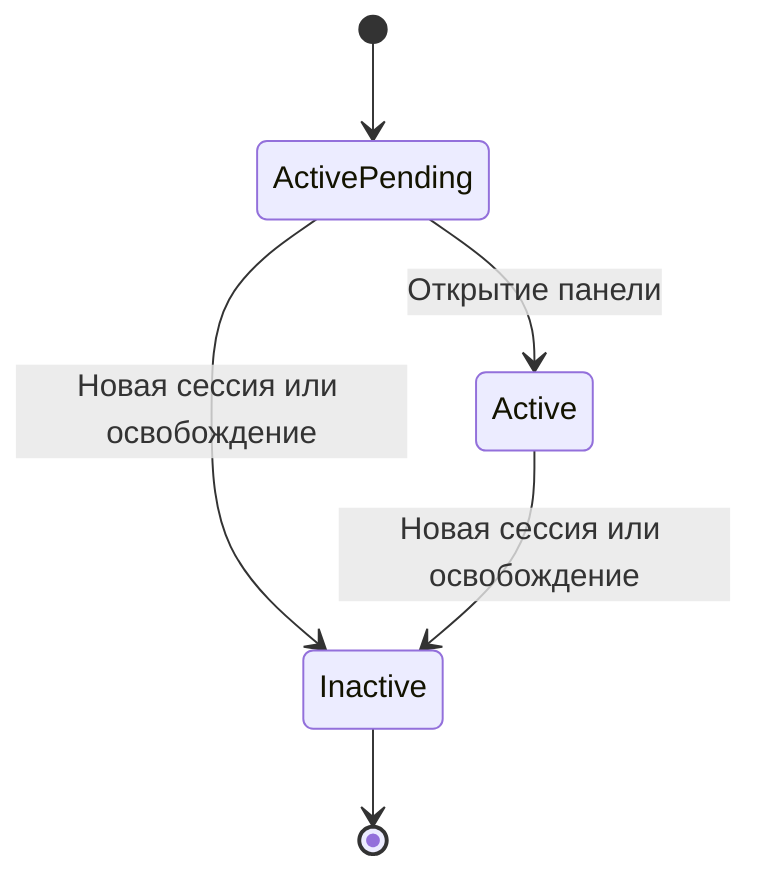
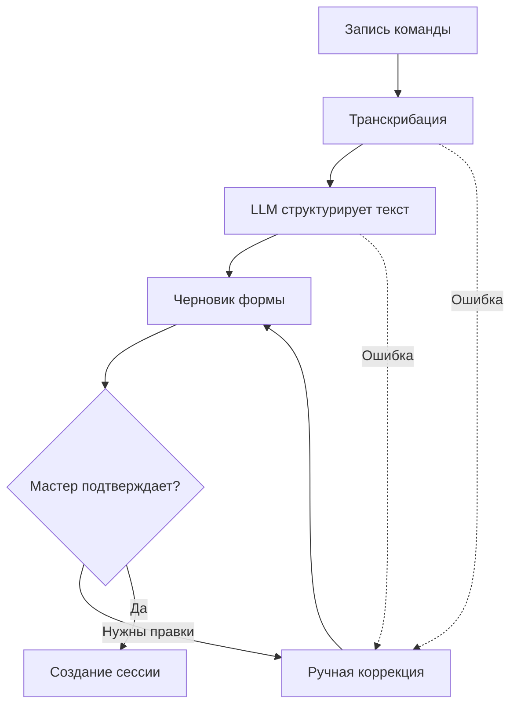

# Диаграммы

[К кейсу](../README.md)

## Sequence: запрос рецепта (AS-IS)

## Жизненный цикл сессии (концептуальное отображение флагов)

masterCalled и mixRequested — независимые флаги, не состояния взаимоисключающей машины. Диаграмма отображает нормальный сценарий интерфейса, не все разрешённые переходы API.

## AI-assisted ввод

## BPMN 2.0

[Открыть исходник BPMN](recipe-request.bpmn) в bpmn.io / Camunda Modeler. Упрощённый процесс запроса рецепта с дорожками гостя, системы и мастера. Графические схемы Mermaid выше — не BPMN.
